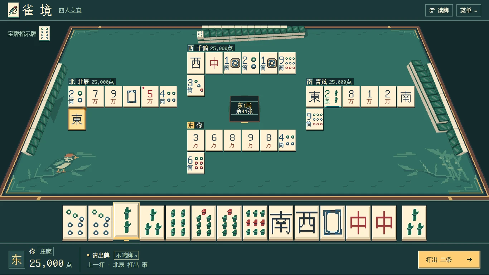

# 雀境 · Jakukyo

基于 TypeScript、React 与 Three.js 的离线单机 3D 麻将游戏。支持 12 种中日玩法、电脑对战与四档 AI、四套牌桌主题、本地音效与 BGM、自动存档、牌谱回放和战绩统计，可在本地浏览器或 Electron Windows 桌面版运行。

## 普通模式 · 实体牌动作

在「游戏设置」里关闭「像素模式」即可体验。普通版出牌是一次短推：离手就翻面，约 160 毫秒落定，牌声与最新弃牌角标都在这一拍，之后不再滑动。路径上有牌山或其他弃牌时才抬高越过；从手牌拖出则接着松手位置走。摸牌、插张和原墩翻宝牌各自保留动作，不反复腾空。

两种桌面的副露都是**直接滑入，不先抬牌**。吃三索时，二索和四索先在两侧摆好，只有三索滑进中间；碰和大明杠也是只动来牌。普通版沿本列短推（标准节奏下碰约 128 毫秒、吃约 160 毫秒），牌墙挡住时从同列靠玩家的一侧滑入。暗杠四张保持间距，贴桌一起滑到副露位；加杠只让第四张沿原碰牌的上表面滑入。普通版连续滑动，像素版分帧平移，牌面方向和高度全程不变。赤五照常按五排列，牌河里的立直宣言牌照常横放。

**副露落定的反馈。** 参考[《雀魂》碰牌的实机画面](https://mahjongsoul.info/wp-content/uploads/2020/01/d7739ddd8a0bdd037ec2359becc312a1.jpg)里用一个动作字报出鸣牌的做法。这里不加人物立绘，也不再给整副牌画光圈：只在落定的牌组旁亮出一个「吃」「碰」或「杠」。普通版用毛笔字、飞白和小朱印；像素版用同一套界面点阵字体、阶梯刻痕和整像素的动作。鸣牌字在约 0.22–0.35 秒内收起；不盖住牌面、不震屏、不拖延下一打。原先的轻叩、双撞、杠的低音都保留，静音仍有字，系统开启「减少动态效果」时只保留牌声。

在「游戏设置 → 试听牌声」可直接听当前画风的三种副露，不必等发到合适的手牌。也可[并排看同一手暗杠：整排滑入，停住才闪「杠」](docs/previews/meld-kan-slide-comparison.webp)。

| 实机预览（WebP Q90、原速） | 吃三索 | 碰红中 | 暗杠一筒 | 试听（吃 → 碰 → 杠） |
| --- | --- | --- | --- | --- |
| 普通版 | [看吃](docs/previews/classic-chi-slide.webp) | [看碰](docs/previews/classic-pon-slide.webp) | [看杠](docs/previews/classic-kan-slide.webp) | [普通牌桌 WAV](docs/previews/classic-meld-sounds.wav) |
| 像素版 | [看吃](docs/previews/pixel-chi-slide.webp) | [看碰](docs/previews/pixel-pon-slide.webp) | [看杠](docs/previews/pixel-kan-slide.webp) | [像素牌桌 WAV](docs/previews/pixel-meld-sounds.wav) |

同一手七万也能看出区别：直接明杠时，只有别人打来的七万滑入（[普通](docs/previews/classic-open-kan-slide.webp) / [像素](docs/previews/pixel-open-kan-slide.webp)）；先碰再加杠时，底下的三张始终不动（[普通](docs/previews/classic-added-kan-slide.webp) / [像素](docs/previews/pixel-added-kan-slide.webp)）。

鼠标停在明副露的任意一张上，或按 Tab 聚焦这组牌，可看「碰 · 对家打出红中」这样的供牌提示；移开或按 Esc 即收起。上家、下家、对家相对看牌者。暗杠不显示来源，旧牌谱缺少来源时不猜测。牌山和对手暗手的亮边降低亮度，明牌与宝牌指示牌保持原色。普通牌河的万、索加强原笔画，像素牌河使用更深的点阵墨色，不缩放字形。开启「减少动态效果」就直接显示最终摆法。

桌面实机预览（同手牌、原速，WebP 质量 90）：吃三索 [普通版](docs/previews/classic-chi-readable.webp) / [像素版](docs/previews/pixel-chi-readable.webp)；碰红中 [普通版](docs/previews/classic-pon-readable.webp) / [像素版](docs/previews/pixel-pon-readable.webp)；查看供牌 [普通桌面](docs/previews/classic-reading-source.webp) / [像素桌面](docs/previews/pixel-reading-source.webp)。

早期[动作对照小样](docs/previews/classic-chi-tracked-comparison.webp)独立保留：两边都是旧的横牌摆法，区别是短推还是从牌河移入。旧摆法参考了[《电脑麻将》作者的副露图解](https://blog.kobalab.net/entry/2026/03/25/074704)，互动参考了[《雀魂》官方对局操作页](https://mahjongsoul.com/startguide/assets/jantama_startguide.pdf#page=14)。`npm run build:offline -- --claim-preview` 保留右边小样的横牌与连续路线，不替换默认版。

## 像素模式

在大厅点右上角的**游戏设置 → 像素模式**；桌面像素对局里，游戏设置在右上角「菜单」中。开关只换画面，会记住选择；四套牌桌主题、当前手牌和存档保持不变。

手牌使用 45 张点阵牌面，含赤五和八张花牌。牌河使用适合小尺寸的数字与花色标记，四家的牌都朝向玩家阅读，立直牌仍然横置。桌心局况、分数和操作提示按屏幕分辨率绘制，不对整幅画面做马赛克缩放。牌面预览与下方实机截图统一使用 **WebP，质量 90**。

**雀刻 · 木版牌桌。** 筒是有方孔的铜钱，条是有切口和墨节的竹枝，万用朱印；一索的栖雀也出现在竹影桌角和大牌和了的五幅落枝动画里。竹影、樱枝、月下山影分别入版，高对比棋室保留素面。装饰留在边缘，读牌区不铺花纹。美术取法于[《铲子骑士》开发者对轮廓、限色和不同动作姿态的拆解](https://old.yachtclubgames.com/2020/03/creating-a-shovel-knight-character-sprite/)，图案与动作均为本项目原创。

桌面摸牌从右侧挑入牌槽，弃牌从对应座位短落到牌河，落点亮出两笔；吃、碰、杠、立直、拔北只在相应座位边短暂盖印。按键、拖牌和下一打不等动画结束。打开系统「减少动态效果」会直接显示落定的牌面；翻牌河、切读牌视图和恢复存档也不会重演旧动作。[实机落牌动图](docs/previews/pixel-print-discard.webp) · [和牌预览动图](docs/previews/pixel-print-win.webp) · [同一牌局旧画面](docs/studies/before-woodcut-1366.webp)

**不必打开读牌面板，就能直接看清弃牌。** 桌面默认将牌河正面铺在各家座位旁，每行六张，远近四家牌面一样大。1366 × 768 对局中普通弃牌为 48 × 60 像素；1920 × 1080 时为 62 × 72。万、筒、条都有数字和花色字，筒、条另保留与手牌相同的圈点和竹节。金色牌面标出上一打，青色底线标出与所选手牌同种的牌；立直横牌的字保持正向，赤五另有菱形标记。

牌河变长后，默认跟随最新一行，座位旁显示当前张数范围；指向牌河可滚轮翻行，键盘聚焦后可用 ↑ / ↓、Home / End。点任意一家即原地打开完整大图，不改变选牌或出牌。布局借鉴[任天堂《役满 DS》将公共弃牌放大、与手牌分开](https://www.nintendo.co.jp/ds/aykj/family/index.html)，以及[世嘉《MJ ARCADE》的弃牌整列与正向显示](https://www.sega-mj.com/arcade/howto/custom/display.html)，牌面使用游戏自制点阵。

桌面像素对局默认是**简洁牌桌**：桌心看局数和余牌，手牌下方看上一打和当前操作。吃、碰、杠、和牌出现时直接点，不用打开面板。右上角只有两个入口：

- **读牌**：需要算牌时展开，再点一次收起。选择会被记住，不改变手牌或对局。游戏内容区至少 **1200 × 640** 时，两侧展开各家完整牌河；为了容纳更多巡，侧栏使用 32 × 44 的数字与花色字牌面，和桌上同样标记立直、同种和最新一打。较小桌面窗口可点「牌河全览」。
- [**菜单**](docs/previews/pixel-desktop-menu.webp)：理牌、切换视角、托管和游戏设置都在这里；牌谱、规则和帮助收在「记录与帮助」里。托管期间，手牌下方始终保留「接管」。

正面手牌和公共桌况分开，布局借鉴了[任天堂《役满 DS》的做法](https://www.nintendo.co.jp/ds/aykj/family/index.html)。宽屏桌面使用两倍点阵；切换视角不改变手牌大小。新摸入的牌与其余牌相隔 12 像素；点选后牌抬起，再点一次、按 Enter、点“打出”或向上拖到桌内松手都能出牌。换三张使用同一排牌进行多选。

中文、拉丁字母、数字、标点和牌面字形取自同一套随游戏内置的 [GNU Unifont 16 点阵字库](https://unifoundry.com/unifont/index.html)。正文用 16 像素，标题按 32 或 48 像素显示；设置、帮助、牌谱、结算和悬停提示遵循相同规则。手机横屏优先收起次要信息，不把字缩小。关闭像素模式即恢复经典排版。

[](docs/previews/pixel-desktop-1366.webp)

[桌上牌河原尺寸局部](docs/previews/pixel-river-native.webp) · [同一局旧版](docs/studies/before-table-rivers.webp) · [点击单家放大](docs/previews/pixel-river-detail.webp) · [展开读牌](docs/previews/pixel-desktop-reading.webp) · [桌面 1920 × 1080](docs/previews/pixel-desktop-1920.webp) · [大厅](docs/previews/pixel-lobby.webp) · [设置](docs/previews/pixel-settings.webp)

## 构建

需要 Node.js **22.12+** 与 npm。

```bash
npm ci                       # 安装依赖
npm run dev                  # 启动开发版
npm run build                # 构建网页资源
npm run build:offline        # 生成可直接打开的单文件离线版
npm run test:classic         # 普通版实机出牌/吃/碰、手牌贴桌与来牌时序、减弱动态及特殊动作
npm run test:meld            # 两种牌桌逐帧检查牌身高度和朝向、鸣牌字与牌声；含三种杠、静音和减少动态效果
npm run test:pixel           # 用本机 Chrome 验证离线版；其他 Chromium 可设置 CHROME_PATH
npm run package:windows:wsl  # 打包 Windows 便携版
```
